# Architecture & Interface Contract: Stake Engine 5x5 Skeleton

Ce document constitue la référence technique officielle définissant l'architecture globale et le contrat d'interface strict entre le moteur mathématique (**Math SDK**) et le client de rendu web (**Web SDK**) pour le boilerplate universel **5x5 Greybox** sur **Stake Engine**.

---

## 1. Vue d'Ensemble de l'Écosystème Stake Engine

L'écosystème Stake Engine sépare rigoureusement la logique probabiliste déterministe (Backend Math) de la présentation multimédia (Frontend Web) :

```mermaid
flowchart LR
    subgraph Math_SDK["Python Math SDK (/math-sdk)"]
        GC["GameConfig (5x5)"] --> GS["GameState (Cluster & Tumble)"]
        GS --> BM["BetModes & Distributions"]
        BM --> CB["create_books()"]
        CB --> Rust["Rust Optimizer (Cargo)"]
        Rust --> Artifacts["Books (.jsonl / .zst) & LUTs (.csv)"]
    end

    subgraph Web_SDK["Web SDK (/web-sdk)"]
        RGS["RGS Fetcher / Mock Book"] --> BEH["bookEventHandlerMap"]
        BEH --> XS["XState Machine"]
        XS --> SG["Svelte 5 Reactive State"]
        SG --> Pixi["PixiJS 8 Canvas (Board 5x5)"]
    end

    Artifacts -.->|"RGS Event Streaming"| RGS
```



1. **Math SDK (`/math-sdk`)** : Moteur Python (>= 3.12) et optimiseur Rust (Cargo) générant :
   - Les **Books** (fichiers JSONL compressés en Zstandard `.zst` ou bruts `.jsonl`) contenant l'intégralité des événements d'un round (chaque ligne = un tour complet).
   - Les **Lookup Tables (LUTs)** au format CSV pour l'échantillonnage instantané côté RGS (Remote Gaming Server).
   - Les sidecars de vérification cryptographique (SHA-256, hash de distribution et PAR sheets).
2. **Web SDK (`/web-sdk`)** : Monorepo TypeScript propulsé par **Turbo**, **Svelte 5** (Runes), **PixiJS 8** et **XState**. Il consomme le flux d'événements du Book pour orchestrer fidèlement les cascades, animations de clusters, multiplicateurs de grille et transitions de bonus.

---

## 2. Contrat d'Interface du Book (Book Event Contract)

Chaque partie de jeu correspond à un tableau ordonné d'événements JSON (`events: BookEvent[]`). Le frontend lit ce tableau séquentiellement via `bookEventHandlerMap`.

### 2.1 Événements du Cycle de Jeu

| Événement (`type`) | Description | Propriétés Clés |
|---|---|---|
| `reveal` | Affiche la grille initiale issue des bandes de rouleaux (avec padding haut/bas). | `board`, `paddingPositions`, `anticipation`, `gameType` |
| `winInfo` | Détaille les clusters gagnants et le calcul des gains. | `totalWin`, `wins: [{ symbol, win, positions, meta }]` |
| `updateGrid` | Met à jour la matrice 5x5 des multiplicateurs de position. | `gridMultipliers: number[][]` |
| `updateGlobalMult` | Met à jour le multiplicateur global du spin/cascade. | `globalMult: number` |
| `updateTumbleWin` | Met à jour le compteur de gain accumulé lors des tumbles successifs. | `amount: number` (en centimes) |
| `tumbleBoard` | Supprime les symboles gagnants et fait chuter les nouveaux symboles. | `explodingSymbols: Position[]`, `newSymbols: RawSymbol[][]` |
| `setTotalWin` | Actualise le gain cumulé total pour la mise courante. | `amount: number` (en centimes) |
| `freeSpinTrigger` | Déclenche l'entrée dans le jeu bonus suite aux Scatters. | `totalFs: number`, `positions: Position[]` |
| `updateFreeSpin` | Notifie le compteur de Free Spins du tour en cours. | `amount: number` (spin courant), `total: number` |
| `freeSpinRetrigger`| Rallonge le bonus lors de nouveaux Scatters durant le Free Game. | `totalFs: number`, `positions: Position[]` |
| `freeSpinEnd` | Clôture la séquence de Free Spins avec son palier de gain. | `amount: number`, `winLevel: number` |
| `wincap` | Indique l'atteinte du plafond maximum de gain (ex. 5000x). | `amount: number` |
| `setWin` | Déclenche le bandeau/popup de gain final avec son niveau d'animation. | `amount: number`, `winLevel: number` |
| `finalWin` | Clôture définitivement le tour et réinitialise les états visuels. | `amount: number` |

### 2.2 Schéma JSON Détaillé des Événements Clés

#### `reveal`
```json
{
  "index": 0,
  "type": "reveal",
  "board": [
    [{"name": "L1"}, {"name": "H1"}, {"name": "L2"}, {"name": "H3"}, {"name": "L4"}, {"name": "H2"}, {"name": "L1"}],
    [{"name": "L2"}, {"name": "H2"}, {"name": "W"}, {"name": "L3"}, {"name": "L1"}, {"name": "H4"}, {"name": "L2"}],
    [{"name": "H3"}, {"name": "L3"}, {"name": "S"}, {"name": "H1"}, {"name": "H2"}, {"name": "L3"}, {"name": "H3"}],
    [{"name": "L4"}, {"name": "H4"}, {"name": "L1"}, {"name": "L2"}, {"name": "W"}, {"name": "H1"}, {"name": "L4"}],
    [{"name": "H1"}, {"name": "L1"}, {"name": "H3"}, {"name": "S"}, {"name": "L2"}, {"name": "L4"}, {"name": "H1"}]
  ],
  "paddingPositions": [14, 28, 5, 19, 42],
  "gameType": "basegame",
  "anticipation": [0, 0, 1, 0, 1]
}
```
*Note : Chaque rouleau contient 7 symboles : index 0 = padding haut, index 1..5 = symboles visibles 5x5, index 6 = padding bas.*

#### `winInfo`
```json
{
  "index": 1,
  "type": "winInfo",
  "totalWin": 500,
  "wins": [
    {
      "symbol": "H1",
      "clusterSize": 5,
      "win": 500,
      "positions": [
        {"reel": 0, "row": 1},
        {"reel": 1, "row": 1},
        {"reel": 1, "row": 2},
        {"reel": 2, "row": 1},
        {"reel": 2, "row": 2}
      ],
      "meta": {
        "globalMult": 1,
        "clusterMult": 2,
        "winWithoutMult": 250,
        "overlay": {"reel": 1, "row": 1}
      }
    }
  ]
}
```

#### `updateGrid`
```json
{
  "index": 2,
  "type": "updateGrid",
  "gridMultipliers": [
    [1, 0, 0, 0, 0],
    [2, 2, 0, 0, 0],
    [1, 1, 0, 0, 0],
    [0, 0, 0, 0, 0],
    [0, 0, 0, 0, 0]
  ]
}
```

#### `tumbleBoard`
```json
{
  "index": 3,
  "type": "tumbleBoard",
  "explodingSymbols": [
    {"reel": 0, "row": 1},
    {"reel": 1, "row": 1},
    {"reel": 1, "row": 2},
    {"reel": 2, "row": 1},
    {"reel": 2, "row": 2}
  ],
  "newSymbols": [
    [{"name": "L3"}],
    [{"name": "H2"}, {"name": "L4"}],
    [{"name": "W"}, {"name": "L1"}],
    [],
    []
  ]
}
```

---

## 3. Configuration Mathématique (`0_0_skeleton_5x5`)

### 3.1 Dimensions et Symboles
- **Grille** : 5 rouleaux x 5 rangées (`num_reels = 5`, `num_rows = [5, 5, 5, 5, 5]`).
- **Symboles Réguliers** :
  - High Pay : `H1`, `H2`, `H3`, `H4`
  - Low Pay : `L1`, `L2`, `L3`, `L4`
- **Symboles Spéciaux** :
  - `W` (Wild) : Se substitue aux symboles payants dans les clusters.
  - `S` (Scatter) : Déclenche les Free Spins (3 Scatters = 10 FS, 4 = 12 FS, 5 = 15 FS).
- **Mécanique de Paiement** : Cluster Pay (minimum 5 symboles connectés orthogonalement).

### 3.2 BetModes & Optimisation
1. **Mode `base`** :
   - Coût : `1.0x`
   - RTP Cible : `96.70%`
   - Wincap : `5000.0x`
   - Distributions : `wincap` (0.1%), `freegame` (10%), `0` (40%), `basegame` (50%).
2. **Mode `bonus` (Bonus Buy)** :
   - Coût : `200x`
   - RTP Cible : `96.70%`
   - Wincap : `5000.0x`
   - Distributions : `wincap` (0.1%), `freegame` (99.9%).

---

## 4. Frontend Web (`skeleton-5x5`)

### 4.1 Pile Technologique
- **Svelte 5** : Réactivité granulaire via Runes (`$state`, `$derived`, `$props`).
- **PixiJS 8** : Moteur de rendu WebGL / WebGPU pour le canvas du slot.
- **XState** : Gestion de machine à états pour le cycle de vie du spin, les interruptions et le jeu auto.
- **Turbo** : Orchestrateur de build monorepo garantissant la compilation ordonnée des packages partagés.

### 4.2 Organisation du Code Frontend
```
web-sdk/apps/skeleton-5x5/
├── src/
│   ├── components/
│   │   ├── Board.svelte             # Conteneur des rouleaux 5x5
│   │   ├── BoardFrame.svelte        # Cadre visuel 5x5
│   │   ├── MultiplierGrid.svelte    # Affichage des multiplicateurs sur chaque cellule
│   │   ├── TumbleBoard.svelte       # Animation de chute des nouveaux symboles
│   │   ├── Win.svelte               # Présentation des Big Win / Super Win
│   │   └── FreeSpinIntro.svelte     # Transitions vers le jeu bonus
│   ├── game/
│   │   ├── bookEventHandlerMap.ts   # Routeur séquentiel des événements du Book
│   │   ├── config.ts                # Configuration alignée sur le GameConfig Python
│   │   ├── constants.ts             # INITIAL_BOARD (5x5), SYMBOL_SIZE, timings
│   │   ├── stateGame.svelte.ts      # État réactif Svelte 5 du plateau
│   │   └── typesBookEvent.ts        # Définitions TypeScript strictes des événements
│   └── routes/
│       └── +layout.svelte           # Point d'entrée SvelteKit avec Context et Auth
```

---

## 5. Guide des Commandes Terminal

### 5.1 Math SDK (Python & Rust)
Depuis le dossier `/math-sdk` (avec l'environnement activé) :

```bash
# Activation de l'environnement virtuel Python 3.12
source env/bin/activate

# Lancer la génération des books, configs et l'optimiseur Rust pour 0_0_skeleton_5x5
python games/0_0_skeleton_5x5/run.py

# Exécuter les tests unitaires et de conformité Stake Engine
pytest tests/
```

### 5.2 Web SDK (Svelte 5, PixiJS 8 & Storybook)
Depuis le dossier `/web-sdk` :

```bash
# Compilation de tous les packages partagés et de l'app skeleton-5x5
pnpm turbo run build --filter=skeleton-5x5...

# Lancer le serveur de développement local (Port 3005)
pnpm --filter skeleton-5x5 dev

# Lancer le Storybook pour tester et prototyper les composants visuels (Port 6005)
pnpm --filter skeleton-5x5 storybook
```
